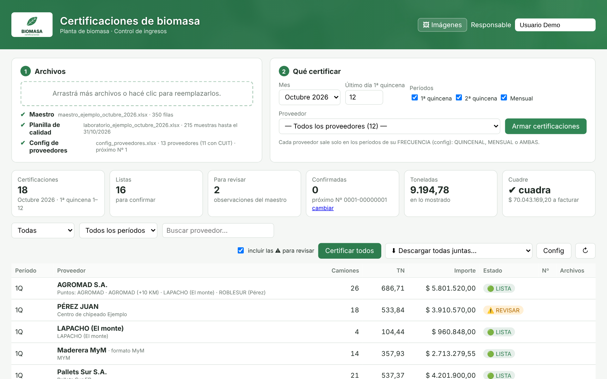
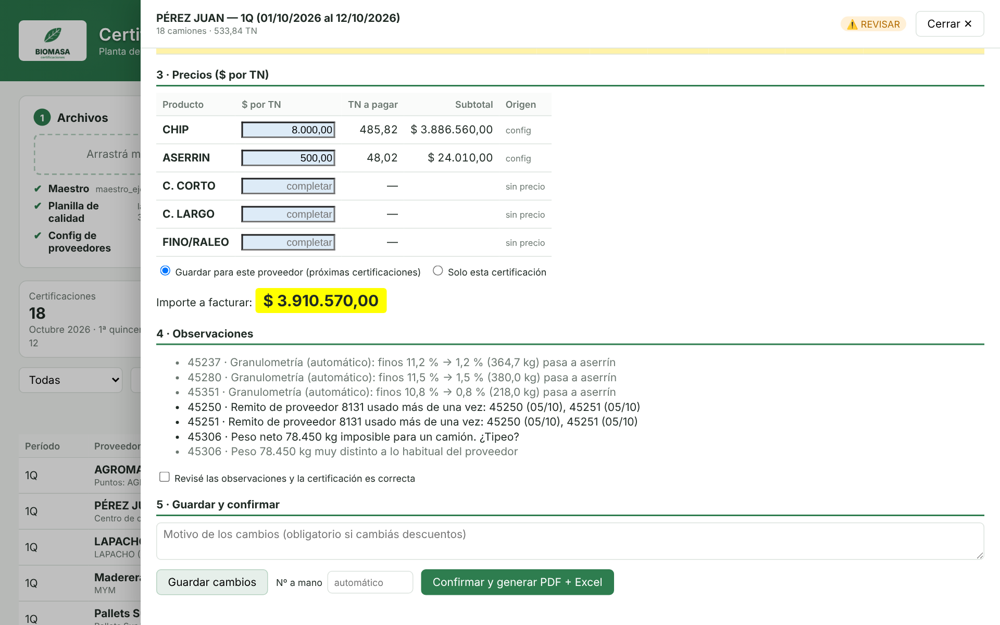
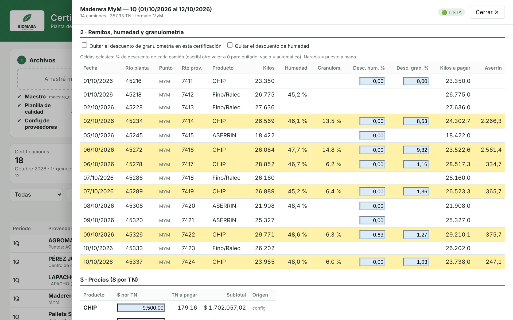
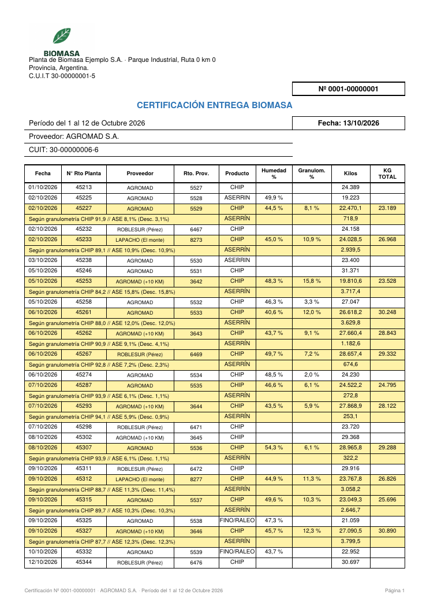

# Sistema web de certificaciones de biomasa

**Versión 3.0.1** · noviembre de 2026

Aplicación web interna que automatiza las certificaciones de entrega de biomasa a proveedores en una planta de generación de energía.

Lee el maestro de ingresos de camiones y la planilla de calidad del laboratorio. Con eso calcula los descuentos por humedad y granulometría camión por camión y genera la certificación de cada proveedor en **PDF y Excel**, con numeración correlativa.

> **Resultado:** el proceso de certificación pasó de **3 jornadas (≈30 horas) a 5 horas por período (83 % menos)**.
> El sistema fue aprobado por la jefatura de planta y el proyecto fue reconocido con un bono extraordinario.



## Qué hace

- **Certificaciones por proveedor:** 1ª quincena, 2ª quincena y mensual. Usa precios por tipología y por tramos de toneladas, unifica puntos de entrega y aplica reglas especiales según la patente o la empresa de transporte.
- **Controles de calidad de datos:**
  - remitos duplicados
  - fechas fuera de secuencia
  - pesos imposibles
  - CUIT con dígito verificador inválido
  - tipologías desconocidas
  - saltos de precio que pueden ser errores de tipeo
- **Integración con el laboratorio:** cada muestra se asigna al camión por N° de remito o por horario de ingreso. Después se aplican los descuentos por humedad (por puntos o por base seca) y por porcentaje de finos.
- **Editor:** permite revisar y corregir cada certificación (descuentos, precios, CUIT). Guarda un registro de cambios con responsable, fecha y motivo, y cuadra automáticamente las toneladas contra el maestro.
- **Descargas consolidadas:**
  - un PDF único con marcadores por proveedor
  - un Excel con un índice y una hoja por certificación
  - un `.zip` con todos los archivos
- **Uso multiusuario en red:** una PC funciona como servidor y las demás entran por navegador, sin instalar nada. Probado con 10 usuarios simultáneos. La numeración es segura ante confirmaciones concurrentes, sin saltos ni duplicados.
- **Seguridad:**
  - usuarios con roles: Administrador, Certificador y Consulta
  - contraseñas con hash PBKDF2
  - HTTPS con certificado propio
  - bloqueo tras intentos fallidos
  - vencimiento de sesión por inactividad
  - registro de accesos

- **Moneda por proveedor** (pesos o dólares), producto *C. largo seco* y nota al pie en cada certificación.
- **Copias de seguridad automáticas** diarias (base de datos incluida), con copia opcional fuera de la PC.
- **Actualización segura:** antes de instalar una versión nueva compara los últimos 6 meses contra la instalada (si cambia un solo importe, no actualiza), hace copia de seguridad, corre las pruebas y, si algo falla, vuelve sola a la versión anterior.
- **Versión portátil:** trae su propio Python con las librerías; no hace falta instalar nada en Windows.

## Novedades de la versión 3

- **Motor modular:** el motor de cálculo pasó de un archivo de ~2.700 líneas a 13 módulos en `motor/` (lectura, laboratorio, descuentos, armado, validación, PDF, Excel…). `cert_biomasa.py` quedó como puerta de entrada, así que el resto del sistema no cambió.
- **Reglas con nombre:** la regla de granulometría es un objeto (`ReglaFinos`: tolerancia y límite) probado contra la versión anterior en 200.000 casos aleatorios.
- **Usuarios y sesiones en SQLite** (antes JSON), con consultas parametrizadas y vencimiento de sesiones.
- **Lista blanca de IP** para el modo red y **config a prueba de Excel abierto** (si está bloqueado, guarda una copia pendiente y la aplica sola).
- **Versiones fijas** de las librerías en `requirements_web.txt`.

## Calidad y pruebas

| Prueba | Qué verifica | Resultado |
|---|---|---|
| `PROBAR_PROGRAMA.bat` (`pruebas/probar.py`) | 61 controles: cálculos, lista blanca, usuarios y sesiones, bloqueo de archivos, copias, seguridad y un mes completo | Se corre antes de cada actualización |
| Regresión sobre datos reales | 12 meses × 2 días de corte, versión 3 contra versión 2.1 | 1.683 certificaciones y 64 PDF/Excel idénticos |
| Prueba de mutación | Un error de 0,06 puntos puesto a propósito en un descuento | La comparación lo detecta (297 diferencias) y frena la actualización |
| `COMPARAR_CON_ACTUAL.bat` (`pruebas/comparar.py`) | Arma los últimos 6 meses con la versión nueva y la instalada y compara importes, toneladas, descuentos, precios, estados, cuadre y texto de los PDF | Tiene que decir **IDÉNTICAS** |

## Capturas

*Todas las capturas usan los datos de ejemplo de la carpeta `ejemplo/` (ficticios).*

| Controles antes de certificar | Descuentos camión por camión |
|---|---|
|  |  |

<p align="center"></p>

## Tecnologías

| Capa | Herramientas |
|---|---|
| Backend / API | Python, FastAPI, Uvicorn |
| Datos | pandas, pyxlsb, openpyxl |
| Documentos | ReportLab (PDF), openpyxl (Excel), pypdf |
| Frontend | HTML, CSS y JavaScript (sin frameworks) |
| Seguridad | hashlib (PBKDF2), cryptography (certificado TLS) |
| Versión anterior | Google Colab + ipywidgets (`editor_colab.py`) |

## Estructura

```
servidor.py              API (FastAPI): sesiones, usuarios, carga de archivos, generación y descargas
motor/                   Motor de cálculo en 13 módulos: base, formato, estilos, descuentos, config, lectura,
                         correcciones, validacion, laboratorio, armado, logo, pdf, excel
cert_biomasa.py          Puerta de entrada al motor (reexporta motor/)
editor_colab.py          Estado de cada mes y editor de certificaciones (también usable desde Colab)
almacen_db.py            Usuarios y sesiones en SQLite
lista_blanca.py          Lista blanca de IP (modo red)
guardado_config.py       Guardado del config a prueba de Excel abierto
respaldo.py              Copias de seguridad automáticas
actualizar.py            Actualización segura y vuelta atrás (ACTUALIZAR_PROGRAMA / VOLVER_A_VERSION_ANTERIOR)
pruebas/                 probar.py (pruebas automáticas) y comparar.py (comparación entre versiones)
index.html / login.html  Interfaz web
config_proveedores.xlsx  Configuración de proveedores, precios y parámetros (DATOS DE EJEMPLO)
ejemplo/                 Maestro y planilla del laboratorio ficticios para probar el sistema
docs/                    Capturas del README
imagenes/                Logo, fondo y color del tema (genéricos)
*.bat                    Scripts de Windows: iniciar, uso en red, firewall, inicio automático, copias, pruebas,
                         comparar, actualizar, volver atrás y acceso directo con ícono
_python.bat / preparar_python.ps1   Versión portátil: usa el Python de la carpeta python/ (lo prepara la primera vez)
LEEME_WEB.txt            Manual de uso completo (en español)
```

## Cómo ejecutarlo

Requiere Python 3.11 o superior.

```bash
pip install -r requirements_web.txt
python servidor.py          # solo esta PC: http://localhost:8000
python servidor.py --red    # en la red local, con usuarios y HTTPS
```

Para correr las pruebas: `python pruebas/probar.py` (o `PROBAR_PROGRAMA.bat`).

En Windows alcanza con hacer doble clic en `INICIAR_WEB.bat` (o `INICIAR_WEB_RED.bat` para usarlo en red). El manual completo está en [`LEEME_WEB.txt`](LEEME_WEB.txt).

### Probarlo con los datos de ejemplo

1. Abrí `http://localhost:8000` y escribí tu nombre en **Responsable**.
2. Arrastrá a la página los tres archivos: `ejemplo/maestro_ejemplo_octubre_2026.xlsx`, `ejemplo/laboratorio_ejemplo_octubre_2026.xlsx` y `config_proveedores.xlsx`.
3. Tocá **Armar certificaciones**: aparecen las 18 certificaciones de octubre 2026 (350 camiones, ≈9.200 TN).
4. Abrí las marcadas como **REVISAR** para ver los errores que el sistema detecta (los datos de ejemplo traen algunos a propósito).
5. **Certificar todos** y descargá los PDF o el Excel.

Los datos de ejemplo se pueden regenerar con `python ejemplo/generar_datos_ejemplo.py`.

## Sobre los datos

**Todos los datos de este repositorio son ficticios:** proveedores, CUIT, patentes, precios, correos, la empresa y su dirección. El logo y las imágenes son genéricos. Se reemplazaron los datos reales para publicar el código; el maestro y la planilla del laboratorio de la carpeta `ejemplo/` son inventados. La carpeta `trabajo/`, donde el programa guarda certificaciones, usuarios y registros, está excluida en `.gitignore`.

## Autor

**Luciano Sebastián Torres** · [LinkedIn](http://www.linkedin.com/in/lucianotorres96)
