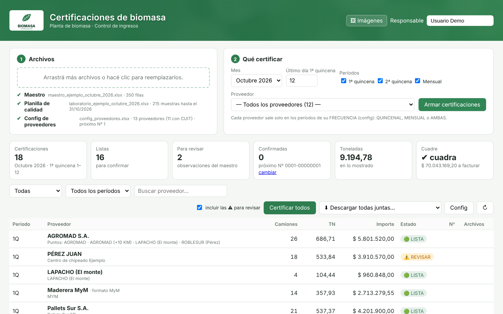
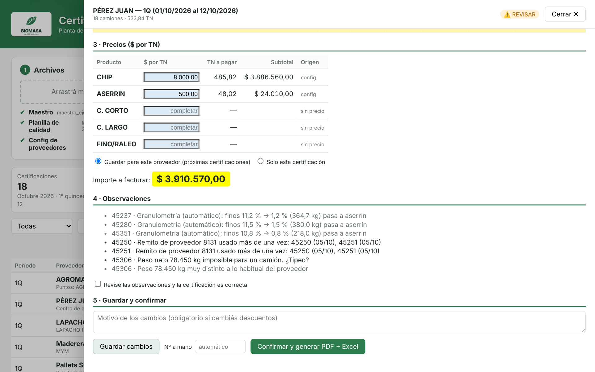
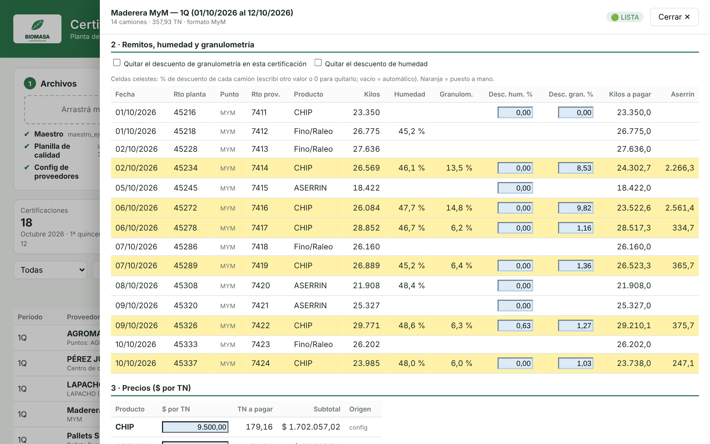
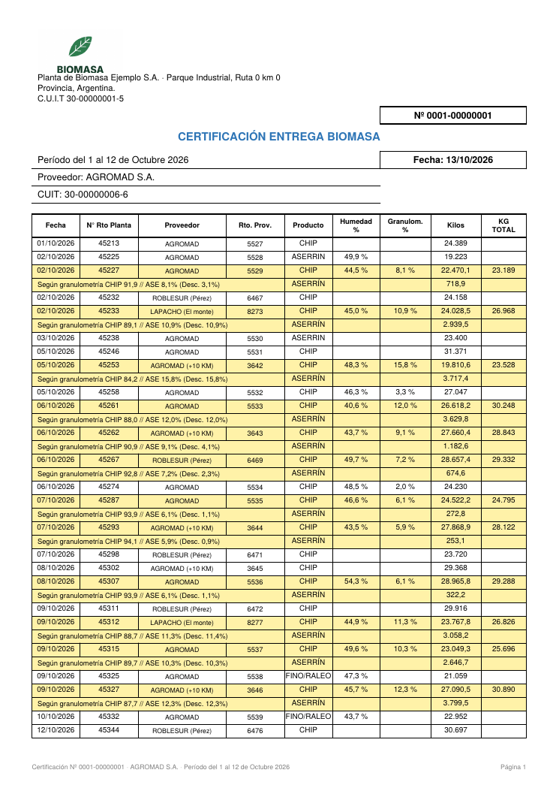

# Sistema web de certificaciones de biomasa

Aplicación web interna que automatiza las certificaciones de entrega de biomasa a proveedores en una planta de generación de energía.

Lee el maestro de ingresos de camiones y la planilla de calidad del laboratorio. Con eso calcula los descuentos por humedad y granulometría camión por camión y genera la certificación de cada proveedor en **PDF y Excel**, con numeración correlativa.

> **Resultado:** el proceso de certificación pasó de **3 jornadas (≈30 horas) a 5 horas por período (83 % menos)**.
> El sistema fue aprobado por la jefatura de planta y el proyecto fue reconocido con un bono extraordinario.



## Qué hace

- **Certificaciones por proveedor:** 1ª quincena, 2ª quincena y mensual. Usa precios por tipología y por tramos de toneladas, unifica puntos de entrega y aplica reglas especiales según la patente o la empresa de transporte.
- **Controles de calidad de datos:**
  - remitos duplicados
  - fechas fuera de secuencia
  - pesos imposibles
  - CUIT con dígito verificador inválido
  - tipologías desconocidas
  - saltos de precio que pueden ser errores de tipeo
- **Integración con el laboratorio:** cada muestra se asigna al camión por N° de remito o por horario de ingreso. Después se aplican los descuentos por humedad (por puntos o por base seca) y por porcentaje de finos.
- **Editor:** permite revisar y corregir cada certificación (descuentos, precios, CUIT). Guarda un registro de cambios con responsable, fecha y motivo, y cuadra automáticamente las toneladas contra el maestro.
- **Descargas consolidadas:**
  - un PDF único con marcadores por proveedor
  - un Excel con un índice y una hoja por certificación
  - un `.zip` con todos los archivos
- **Uso multiusuario en red:** una PC funciona como servidor y las demás entran por navegador, sin instalar nada. Probado con 10 usuarios simultáneos. La numeración es segura ante confirmaciones concurrentes, sin saltos ni duplicados.
- **Seguridad:**
  - usuarios con roles: Administrador, Certificador y Consulta
  - contraseñas con hash PBKDF2
  - HTTPS con certificado propio
  - bloqueo tras intentos fallidos
  - vencimiento de sesión por inactividad
  - registro de accesos

## Capturas

*Todas las capturas usan los datos de ejemplo de la carpeta `ejemplo/` (ficticios).*

| Controles antes de certificar | Descuentos camión por camión |
|---|---|
|  |  |

<p align="center"></p>

## Tecnologías

| Capa | Herramientas |
|---|---|
| Backend / API | Python, FastAPI, Uvicorn |
| Datos | pandas, pyxlsb, openpyxl |
| Documentos | ReportLab (PDF), openpyxl (Excel), pypdf |
| Frontend | HTML, CSS y JavaScript (sin frameworks) |
| Seguridad | hashlib (PBKDF2), cryptography (certificado TLS) |
| Versión anterior | Google Colab + ipywidgets (`editor_colab.py`) |

## Estructura

```
servidor.py              API (FastAPI): sesiones, usuarios, carga de archivos, generación y descargas
cert_biomasa.py          Motor de cálculo: lectura del maestro, controles, descuentos, PDF y Excel
editor_colab.py          Editor de certificaciones (versión cuaderno de Colab)
index.html / login.html  Interfaz web
config_proveedores.xlsx  Configuración de proveedores, precios y parámetros (DATOS DE EJEMPLO)
ejemplo/                 Maestro y planilla del laboratorio ficticios para probar el sistema
docs/                    Capturas del README
imagenes/                Logo, fondo y color del tema (genéricos)
*.bat                    Scripts de Windows: iniciar, uso en red, firewall, inicio automático, copias de seguridad
LEEME_WEB.txt            Manual de uso completo (en español)
```

## Cómo ejecutarlo

Requiere Python 3.11 o superior.

```bash
pip install -r requirements_web.txt
python servidor.py          # solo esta PC: http://localhost:8000
python servidor.py --red    # en la red local, con usuarios y HTTPS
```

En Windows alcanza con hacer doble clic en `INICIAR_WEB.bat` (o `INICIAR_WEB_RED.bat` para usarlo en red). El manual completo está en [`LEEME_WEB.txt`](LEEME_WEB.txt).

### Probarlo con los datos de ejemplo

1. Abrí `http://localhost:8000` y escribí tu nombre en **Responsable**.
2. Arrastrá a la página los tres archivos: `ejemplo/maestro_ejemplo_octubre_2026.xlsx`, `ejemplo/laboratorio_ejemplo_octubre_2026.xlsx` y `config_proveedores.xlsx`.
3. Tocá **Armar certificaciones**: aparecen las 18 certificaciones de octubre 2026 (350 camiones, ≈9.200 TN).
4. Abrí las marcadas como **REVISAR** para ver los errores que el sistema detecta (los datos de ejemplo traen algunos a propósito).
5. **Certificar todos** y descargá los PDF o el Excel.

Los datos de ejemplo se pueden regenerar con `python ejemplo/generar_datos_ejemplo.py`.

## Sobre los datos

**Todos los datos de este repositorio son ficticios:** proveedores, CUIT, patentes, precios, correos, la empresa y su dirección. El logo y las imágenes son genéricos. Se reemplazaron los datos reales para publicar el código; el maestro y la planilla del laboratorio de la carpeta `ejemplo/` son inventados. La carpeta `trabajo/`, donde el programa guarda certificaciones, usuarios y registros, está excluida en `.gitignore`.

## Autor

**Luciano Sebastián Torres** · [LinkedIn](http://www.linkedin.com/in/lucianotorres96)
